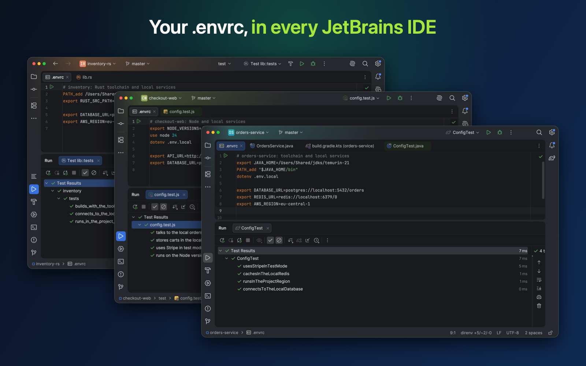
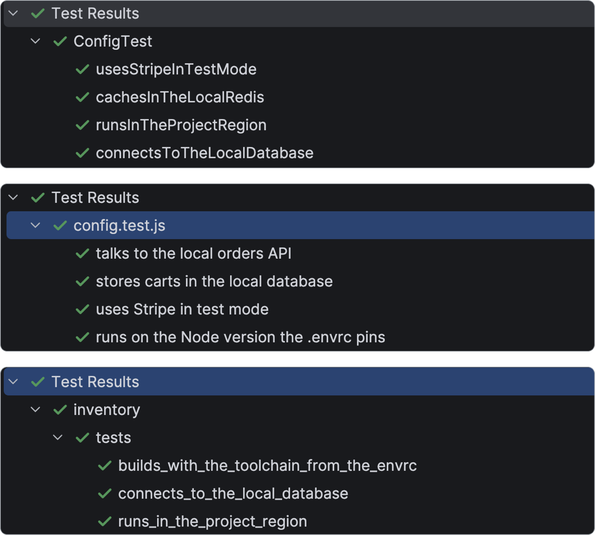
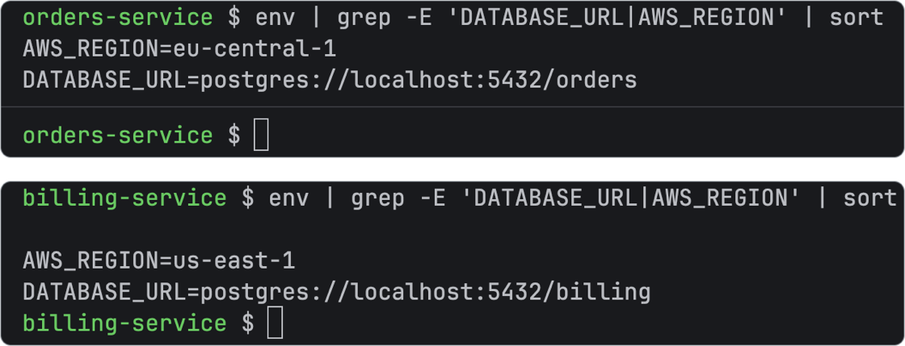
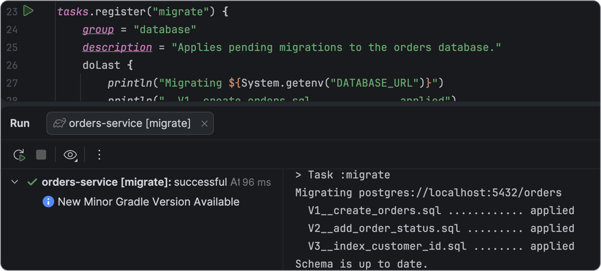
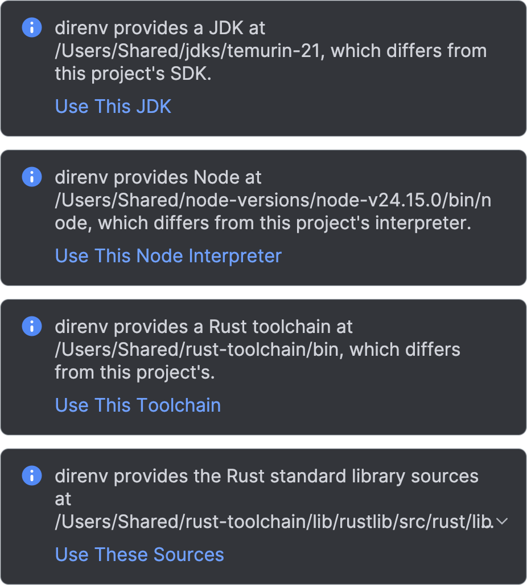
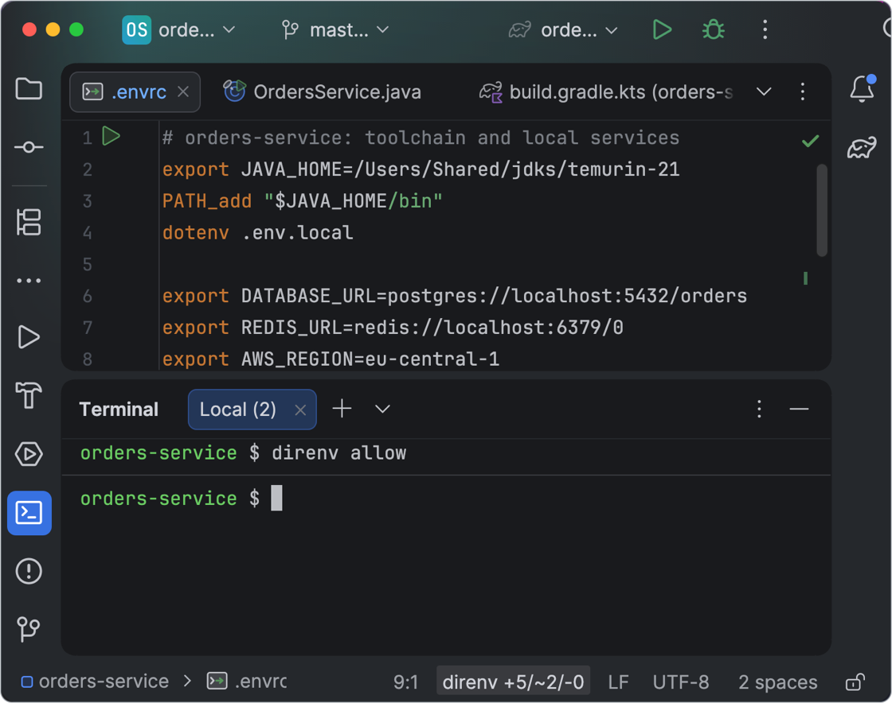
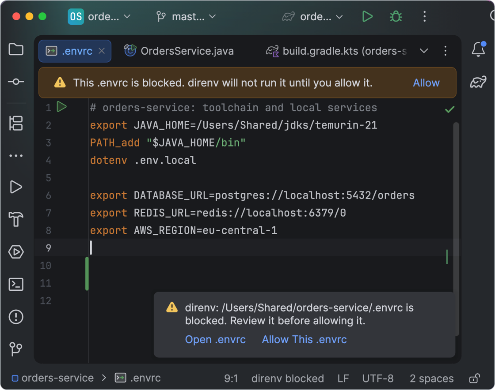
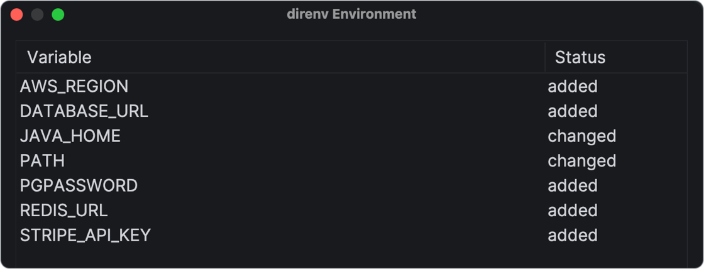

<p align="center">
  <picture>
    <source media="(prefers-color-scheme: dark)" srcset="src/main/resources/META-INF/pluginIcon_dark.svg">
    
  </picture>
</p>

<h1 align="center">direnv Everywhere</h1>

<p align="center">
  <b>direnv for IntelliJ IDEA, PyCharm, GoLand, WebStorm, RustRover and the other JetBrains IDEs.<br>
  Your <code>.envrc</code> in every run configuration, test, Gradle and Maven build, and terminal, per project.</b>
</p>

<p align="center">
  <a href="https://plugins.jetbrains.com/plugin/33482-direnv-everywhere"></a>
  <a href="https://plugins.jetbrains.com/plugin/33482-direnv-everywhere"></a>
  <a href="https://plugins.jetbrains.com/plugin/33482-direnv-everywhere/reviews"></a>
  <a href="https://github.com/salatmaster/direnv-jetbrains-plugin/actions/workflows/build.yml"></a>
  <a href="LICENSE"></a>
</p>

<p align="center">
  
</p>

In the terminal, your Nix flake, devenv or Devbox shell has everything. In the IDE, run configurations
and tests start without it, and the usual workaround, launching the IDE from that shell, gives every
project the same environment. **direnv Everywhere** loads each project's `.envrc` into every process the
IDE starts and keeps it current, without copying a single value into run configurations or `.idea/`.

It works with anything direnv loads: [nix-direnv](https://github.com/nix-community/nix-direnv) and
`use flake`, [devenv](https://devenv.sh), [Devbox](https://www.jetify.com/devbox), `use node`, `.env`
files and plain `export`s. It implements [IJPL-11588](https://youtrack.jetbrains.com/issue/IJPL-11588),
a request open at JetBrains since 2023.

## Features



### Every run configuration, in every language

JUnit, `node --test`, `cargo test`, pytest, Go tests, npm scripts, the application itself: whatever the
IDE starts gets the environment, and so does the build. Nothing to switch on per configuration, because
the plugin hooks the platform below run configurations instead of supporting one runner at a time.

<br clear="all">
<br>



### Every project its own environment

Open two projects side by side, and each keeps its own variables, in its terminal as in its run
configurations. An `.envrc` in a subdirectory gets its own too. The IDE's own environment is never
touched, which is what keeps them apart.

<br clear="all">
<br>



### Gradle, Maven and git hooks

Gradle sync and tasks, Maven goals, External Tools and the `pre-commit` hook of a commit from the IDE
see the same variables. The IDE starts Gradle and Maven in ways an ordinary process hook never sees,
so each has an integration of its own.

<br clear="all">
<br>



### The JDK, Node and Rust from your shell

The editor resolves code against the IDE's own SDK settings, not `PATH`, so a JDK from Nix stays
missing there while the terminal finds it. When direnv provides a JDK, a Node interpreter, a Rust
toolchain or the Rust standard library, the plugin offers it. Only offers: a Nix store path can vanish
after garbage collection, and an SDK that changed silently would break the project with no explanation.

<br clear="all">
<br>



### Reloads by itself

Edit `.envrc` or update `flake.lock`, and the environment reloads: the plugin watches every file direnv
reports, not just `.envrc`. Run `direnv allow` in any terminal, and the IDE picks it up within seconds.

<br clear="all">
<br>



### Nothing runs until you allow it

An `.envrc` is shell code. The plugin never runs `direnv allow` for you, never runs an `.envrc` in a
project you haven't trusted, and offers to open the file before it offers to allow it.

<br clear="all">
<br>



### Names, never values

direnv output is full of secrets, so values never reach logs, run configurations or any file under
`.idea/`, where they would end up in git. To see what was applied, click the status bar: every
variable by name, and whether direnv added, changed or removed it.

<br clear="all">
<br>

**Also:** for a project in WSL, direnv runs inside the distribution, where the project lives.

## Getting started

1. **Install the plugin:** <kbd>Settings</kbd> → <kbd>Plugins</kbd> → <kbd>Marketplace</kbd>, search
   for *direnv Everywhere*. Or download the zip from
   [Releases](https://github.com/salatmaster/direnv-jetbrains-plugin/releases) and use *Install Plugin
   from Disk…*.
2. **Install [direnv](https://direnv.net/docs/installation.html)** and have it on `PATH`. The IDE does
   not need the shell hook.
3. **Open a project with an `.envrc`.** If it isn't allowed yet, read it, then click **Allow**, or run
   `direnv allow` in a terminal.

The status bar then shows `direnv +5/~2/-0`: variables added, changed and removed. Click it to reload, to
open the `.envrc`, or to see what was applied.

**Requirements:** IntelliJ IDEA, PyCharm, GoLand, WebStorm, RustRover, CLion, PhpStorm or RubyMine,
2026.1 or newer. Verified against IDEA Community, IDEA Ultimate, PyCharm Community and RustRover. The
2026.1 floor is the first release whose terminal works correctly across machine boundaries such as WSL.

## How it compares

Four other direnv plugins are published on the JetBrains Marketplace. The table is built from their
own Marketplace descriptions and, where the source is public, from their code, checked in August 2026
against the versions current then. A dash means the plugin does not offer or document the capability,
not that it was tested and failed. Corrections are welcome as issues.

<table>
  <tr>
    <th align="left"></th>
    <th><br>direnv&nbsp;Everywhere</th>
    <th><a href="https://plugins.jetbrains.com/plugin/19275-better-direnv">better_direnv</a></th>
    <th><a href="https://plugins.jetbrains.com/plugin/28160-direnv-pro">DirEnv&nbsp;Pro</a></th>
    <th><a href="https://plugins.jetbrains.com/plugin/30539-direnv">Direnv</a></th>
    <th><a href="https://plugins.jetbrains.com/plugin/30187-direnv-loader">Direnv&nbsp;Loader</a></th>
  </tr>
  <tr>
    <td colspan="6"><br><b>Where the environment reaches</b></td>
  </tr>
  <tr>
    <td>Run and debug configurations</td>
    <td align="center">✅</td>
    <td align="center">🟡 six languages<sup>1</sup></td>
    <td align="center">—</td>
    <td align="center">✅</td>
    <td align="center">✅</td>
  </tr>
  <tr>
    <td>Gradle sync and tasks, Maven</td>
    <td align="center">✅</td>
    <td align="center">—</td>
    <td align="center">—</td>
    <td align="center">🟡 run configs only</td>
    <td align="center">🟡 Gradle tasks</td>
  </tr>
  <tr>
    <td>Terminal</td>
    <td align="center">✅</td>
    <td align="center">—</td>
    <td align="center">—</td>
    <td align="center">—</td>
    <td align="center">—</td>
  </tr>
  <tr>
    <td>Build, External Tools, other plugins' processes</td>
    <td align="center">✅</td>
    <td align="center">—</td>
    <td align="center">—</td>
    <td align="center">—</td>
    <td align="center">—</td>
  </tr>
  <tr>
    <td>Nothing to switch on per run configuration</td>
    <td align="center">✅</td>
    <td align="center">🟡 a checkbox each</td>
    <td align="center">🟡 load by hand</td>
    <td align="center">✅</td>
    <td align="center">🟡 a checkbox each</td>
  </tr>
  <tr>
    <td colspan="6"><br><b>Projects and toolchains</b></td>
  </tr>
  <tr>
    <td>Projects side by side keep separate environments</td>
    <td align="center">✅</td>
    <td align="center">—</td>
    <td align="center">—</td>
    <td align="center">—</td>
    <td align="center">—</td>
  </tr>
  <tr>
    <td>An <code>.envrc</code> below the project root</td>
    <td align="center">✅</td>
    <td align="center">—</td>
    <td align="center">🟡 root only</td>
    <td align="center">🟡 by hand</td>
    <td align="center">—</td>
  </tr>
  <tr>
    <td>JDK, Node and Rust from direnv offered to the project</td>
    <td align="center">✅</td>
    <td align="center">—</td>
    <td align="center">—</td>
    <td align="center">—</td>
    <td align="center">—</td>
  </tr>
  <tr>
    <td colspan="6"><br><b>Staying current</b></td>
  </tr>
  <tr>
    <td>Reloads on <code>flake.lock</code>, <code>.env</code>, …</td>
    <td align="center">✅</td>
    <td align="center">🟡 discarded<sup>2</sup></td>
    <td align="center">🟡 <code>.envrc</code> on save</td>
    <td align="center">—</td>
    <td align="center">—</td>
  </tr>
  <tr>
    <td>Notices <code>direnv allow</code> run in a terminal</td>
    <td align="center">✅</td>
    <td align="center">—</td>
    <td align="center">—</td>
    <td align="center">—</td>
    <td align="center">—</td>
  </tr>
  <tr>
    <td colspan="6"><br><b>Safety</b></td>
  </tr>
  <tr>
    <td>Never runs <code>direnv allow</code> for you</td>
    <td align="center">✅</td>
    <td align="center">🟡 opt-in auto-allow</td>
    <td align="center">—</td>
    <td align="center">—</td>
    <td align="center">🟡 opt-in auto-allow</td>
  </tr>
  <tr>
    <td>Nothing executes in an untrusted project</td>
    <td align="center">✅</td>
    <td align="center">—</td>
    <td align="center">—</td>
    <td align="center">—</td>
    <td align="center">—</td>
  </tr>
  <tr>
    <td>Values stay out of run configs and <code>.idea/</code></td>
    <td align="center">✅</td>
    <td align="center">✅</td>
    <td align="center">—</td>
    <td align="center">🟡 written in<sup>3</sup></td>
    <td align="center">✅</td>
  </tr>
</table>

<sub>✅ yes · 🟡 partly · — not offered or not documented.
<sup>1</sup> Java, Go, Node.js, Python, PHP and Ruby; its description notes that "each run configuration
type needs to be added manually". <sup>2</sup> It deletes <code>DIRENV_WATCHES</code> from the exported
environment, so nothing outside <code>.envrc</code> can trigger a reload. <sup>3</sup> By design: values
are merged into the Environment Variables field of every run configuration, and saved with it.</sub>

**What they do that this plugin does not.** better_direnv has been maintained far longer than this one.

## How it works

The environment is resolved per project and working directory, then injected as each process starts.
The IDE's own process environment is never modified, which is what keeps two open projects apart.

Changes are noticed through file events and a two-second poll of the files direnv watches. The poll is
not redundant: the IDE delivers no events for direnv's allow stamps under `~/.local/share/direnv`, so a
`direnv allow` in a terminal would otherwise go unnoticed. direnv itself detects changes the same way,
by comparing modification times.

## Limitations

- **A process started before the first load gets no environment.** Opening the project starts the
  load, so it is ready long before you run anything. The terminal and Gradle wait for it.
- **Git hooks run only with *Run Git hooks* on** in the commit options. That is the IDE's setting.
- **Indexing does not follow `PATH`.** Toolchains are offered rather than applied, as described above.
- **Docker, SSH and remote interpreters** bypass the hook the plugin uses.
- **A variable direnv unsets survives in Gradle and Maven builds.** Both take their environment through
  an API that can only add. Everywhere else, unsets are honoured.
- **WSL is confirmed; other remote machines are untested.** SSH and container-backed projects take the
  same code path, but nobody has run one yet.
- **Toolchain suggestions cover Java, Node.js and Rust.** Go and Python need only their product module.

<details>
<summary><b>When the environment does not arrive</b></summary>

<br>

A process starting without the direnv environment looks exactly like a process starting with it, so
the plugin explains itself. Turn its logging on in **Help → Diagnostic Tools → Debug Log Settings** by
adding

```
io.github.salatmaster.direnv
```

then reproduce the problem and open **Help → Show Log in Finder**. Every process the IDE starts leaves
one line: either how many variables were injected, or why none were.

| The log says | What it means |
| --- | --- |
| `no environment is loaded for it` | direnv has not run for that directory. Check the status bar; if it shows nothing, the project may have opened before direnv finished. |
| `no open project contains it` | the working directory lies outside every content root of every open project. The plugin will not guess which project's environment to use, because guessing wrong leaks one project's secrets into another. |
| `direnv is off or the project is untrusted` | either the plugin is disabled under Tools → direnv, or the project has not been trusted. |
| `the command line has no working directory` | the process was started without one. Harmless once per Gradle execution: the IDE computes Gradle's environment through a throwaway command line, and Gradle has an injection point of its own. |

Those lines are the useful part of a bug report. They name no variables and no values: even a name can
disclose which service a project talks to.

</details>

## Building and contributing

```bash
./gradlew buildPlugin   # plugin ZIP in build/distributions/
./gradlew test          # direnv is NOT required to run the tests
./gradlew runIde        # sandbox IDE with the plugin installed
```

The build provisions its own JDK 21, so a clean checkout builds without installing anything first.
[CONTRIBUTING.md](CONTRIBUTING.md) covers the module layout, how to add support for another IDE, and
the rules a change must not break. Release notes are in [CHANGELOG.md](CHANGELOG.md).
[direnv-vscode](https://github.com/direnv/direnv-vscode) served as the reference for direnv's behaviour.

## License

[Apache-2.0](LICENSE).
